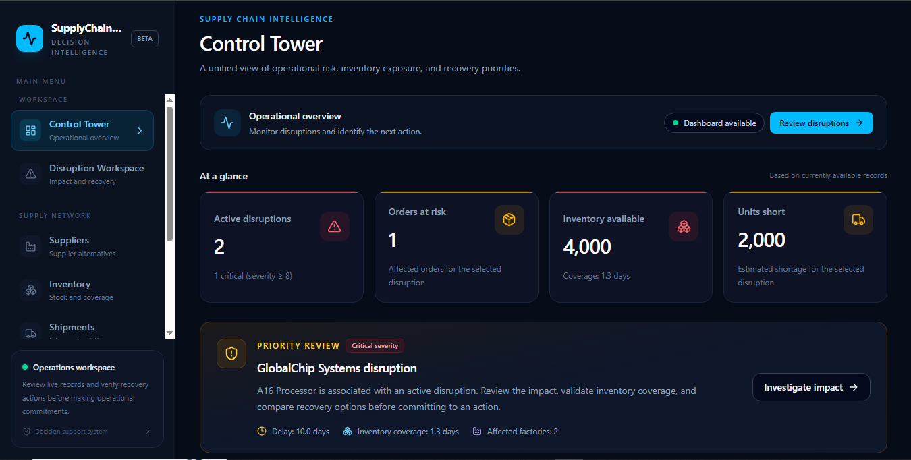
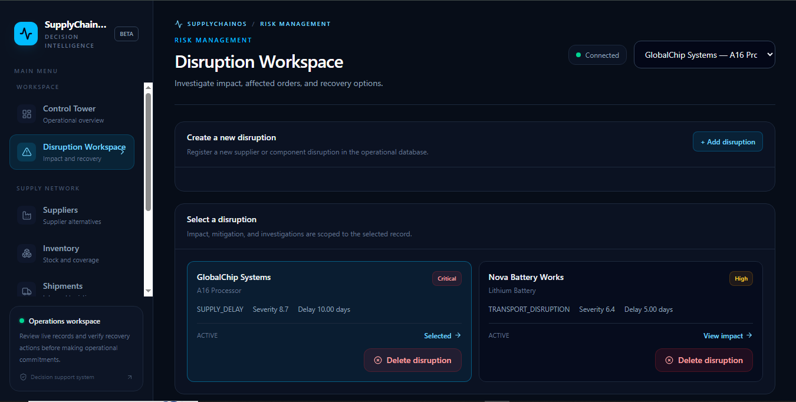
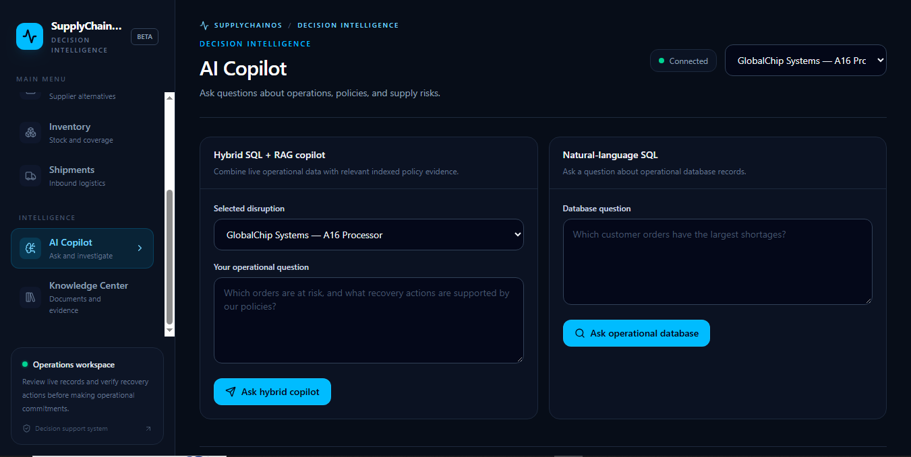
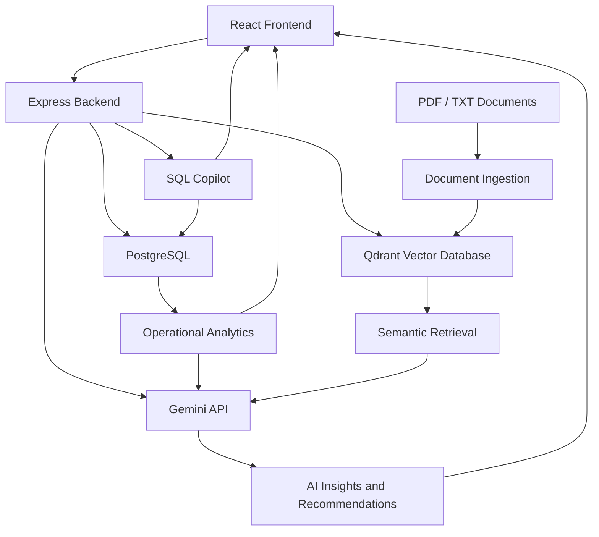

# SupplyChainOS 🚀
### AI-Powered Supply Chain Decision Intelligence Platform

SupplyChainOS is a full-stack, AI-powered supply chain decision intelligence platform designed to help organizations monitor supply chain disruptions, evaluate operational risks, analyze inventory shortages, and explore recovery strategies.

It combines traditional backend business logic with Generative AI, Retrieval-Augmented Generation (RAG), and Natural Language to SQL capabilities to turn operational data into actionable insights.

---

## 🌟 Key Features

### 1. Control Tower Dashboard
- Centralized overview of supply chain operations.
- Monitor supplier disruptions and operational status.
- View inventory, shipment, and order-related information.
- Track critical metrics through interactive dashboards.

### 2. Disruption Management
- Create and manage supplier or component disruptions.
- Record disruption type, severity, delay, description, and expected resolution date.
- Delete disruptions when they are no longer required.
- Dynamically calculate the impact of individual disruptions.

### 3. Supply Chain Impact Analysis
- Analyze affected products and factories.
- Calculate inventory coverage and potential supply gaps.
- Identify affected customer orders.
- Estimate product shortages using inventory allocation logic.
- Evaluate incoming shipments and their expected delivery dates.

### 4. AI-Powered Investigation
- Generate AI-based disruption investigations.
- Analyze affected customer orders.
- Generate contextual explanations and recommendations.
- Provide insights using operational data and calculated impact information.

### 5. Intelligent Mitigation Planning
Evaluate different recovery strategies, including:
- Emergency procurement from alternative suppliers.
- Waiting for the original supplier.
- Production adjustments.

Compare estimated costs, lead times, and supply gap implications before making operational decisions.

### 6. RAG-Based Knowledge Assistant
- Upload PDF and TXT documents.
- Process and index documents for semantic retrieval.
- Store and retrieve vector embeddings using Qdrant.
- Ask questions about uploaded operational documents.
- Generate context-aware answers using retrieved information and Gemini.

### 7. Hybrid AI Copilot
Combines structured database queries and document-based knowledge retrieval.

- Retrieve relevant information from PostgreSQL.
- Search uploaded documents using RAG.
- Combine structured operational data with contextual knowledge.
- Generate unified answers through an AI-powered interface.

### 8. Natural Language to SQL
- Ask database questions using natural language.
- Generate SQL queries using AI.
- Execute permitted read-only queries against PostgreSQL.
- Apply query validation, execution timeouts, and result limits.

---
## 📸 Screenshots

### Control Tower


### Disruption Workspace


### AI Copilot


## 🛠️ Technology Stack

| Category | Technologies |
|---|---|
| Frontend | React.js, Vite, Tailwind CSS |
| Backend | Node.js, Express.js |
| Database | PostgreSQL |
| AI / LLM | Google Gemini API |
| Vector Database | Qdrant |
| AI Architecture | RAG, Natural Language to SQL, Hybrid Retrieval |
| API Communication | REST APIs |
| Development Tools | Git, GitHub, VS Code, Docker |

---

## 🏗️ System Architecture



---

## 🔄 How It Works

1. **Operational Data:** Supply chain information such as suppliers, components, inventory, shipments, factories, and customer orders is stored in PostgreSQL.

2. **Disruption Detection:** Users register disruptions and select the affected supplier and component.

3. **Impact Calculation:** Backend services analyze inventory availability, incoming shipments, production requirements, and customer orders.

4. **AI Investigation:** Gemini receives relevant operational context and generates explanations and recommendations.

5. **Knowledge Retrieval:** Uploaded documents are processed, indexed, and stored in Qdrant for semantic search.

6. **Hybrid Intelligence:** The Copilot combines database-backed information and document retrieval to answer complex operational questions.

7. **Decision Support:** Results are presented through interactive dashboards, impact reports, and recovery estimates.

---

## 📂 Project Structure

```text
SupplyChainOS/
│
├── frontend/
│   ├── public/
│   ├── src/
│   │   ├── assets/
│   │   ├── components/
│   │   │   └── dashboard/
│   │   ├── App.jsx
│   │   ├── App.css
│   │   ├── index.css
│   │   └── main.jsx
│   ├── package.json
│   └── vite.config.js
│
├── backend/
│   ├── src/
│   │   ├── controllers/
│   │   ├── routes/
│   │   ├── services/
│   │   ├── utils/
│   │   ├── seed/
│   │   └── db.js
│   ├── package.json
│   └── tests/
│
├── README.md
└── .gitignore
```

*The structure above is a simplified overview. Additional files and configuration may exist in individual directories.*

---

## ⚙️ Installation and Setup

### Prerequisites

Make sure you have installed:

- Node.js and npm
- PostgreSQL
- Docker Desktop
- Google Gemini API key
- Git

### 1. Clone the Repository

```bash
git clone https://github.com/shivansh-127/SupplyChainOS.git

cd SupplyChainOS
```

### 2. Backend Setup

```bash
cd backend

npm install
```

Create a `.env` file inside the backend directory and configure the environment variables required by your backend:

```env
PORT=5000

DB_HOST=localhost
DB_PORT=5432
DB_NAME=your_database_name
DB_USER=your_database_user
DB_PASSWORD=your_database_password

GEMINI_API_KEY=your_gemini_api_key

NL_SQL_DB_USER=your_readonly_database_user
NL_SQL_DB_PASSWORD=your_readonly_database_password

```

### 3. Start Qdrant

Run Qdrant locally using Docker:

```bash
docker run -d \
  --name qdrant \
  -p 6333:6333 \
  -p 6334:6334 \
  qdrant/qdrant
```

### 4. Configure PostgreSQL

- Create the PostgreSQL database.
- Configure the database connection.
- Execute the database schema and seed scripts provided in the backend.
- Ensure the required tables and relationships are initialized.

### 5. Start the Backend

```bash
npm start
```

Use the development script defined in `backend/package.json` if you prefer automatic restarts.

The backend runs on:

```text
http://localhost:5000
```

### 6. Frontend Setup

Open another terminal:

```bash
cd frontend

npm install

npm run dev
```

The frontend runs at:

```text
http://localhost:5173
```

---

## 🔌 Core API Endpoints

Base URL: `http://localhost:5000/api`

| Method | Endpoint | Description |
|---|---|---|
| GET | `/disruptions` | Retrieve disruptions |
| POST | `/disruptions` | Create a disruption |
| DELETE | `/disruptions/:id` | Delete a disruption |
| GET | `/disruptions/:id/impact` | Analyze disruption impact |
| GET | `/disruptions/:id/mitigation` | Retrieve mitigation estimates |
| POST | `/disruptions/:id/investigate` | Run AI disruption investigation |
| POST | `/disruptions/:id/orders/:orderId/investigate` | Investigate an affected order |
| POST | `/knowledge/upload` | Upload and index documents |
| POST | `/knowledge/ask` | Ask questions using RAG |
| POST | `/knowledge/ask-disruption` | Ask disruption-related knowledge questions |
| POST | `/nl-sql/ask` | Ask database questions using natural language |

---

## 🧠 Core Technical Concepts

This project demonstrates practical implementation of:

- **RESTful API Development:** Designing and integrating backend endpoints.
- **Relational Database Design:** Managing connected supply chain entities using PostgreSQL.
- **Inventory Allocation Algorithms:** Allocating available inventory and eligible incoming shipments against customer orders.
- **Generative AI Integration:** Using Gemini for contextual analysis and recommendations.
- **Retrieval-Augmented Generation:** Retrieving relevant document context before generating answers.
- **Vector Search:** Using Qdrant for semantic document retrieval.
- **Natural Language to SQL:** Translating natural-language questions into database queries.
- **Read-Only Query Safety:** Validating generated SQL and restricting database operations.

---

## 🔐 Safety and Reliability

- Read-only restrictions for the Natural Language to SQL feature.
- Query execution timeouts and result limits.
- Input validation for important backend operations.
- Separation of frontend, backend, database, and AI services.
- Environment-based configuration for sensitive credentials.

**Note:** This project is a decision-support prototype. Inventory calculations, disruption impacts, and mitigation costs are estimates based on the available operational data and implemented assumptions. They should be verified before real-world operational decisions.

---

## 🚀 Future Scope

Potential future enhancements include:

- Integration with live ERP and supply chain systems.
- Real-time shipment tracking.
- Advanced supplier risk scoring.
- Predictive disruption detection.
- More sophisticated demand forecasting.
- Role-based access control and audit trails.
- Production deployment and scalable infrastructure.

---

## 👨‍💻 Author

**Shivansh Saxena**

B.Tech – Computer Science and Engineering

Interested in Full Stack Development, Backend Engineering, and AI-powered applications.

---

## ⭐ Support

If you find this project interesting, consider giving the repository a star!

**SupplyChainOS — Turning Supply Chain Data into Intelligent Decisions.**
